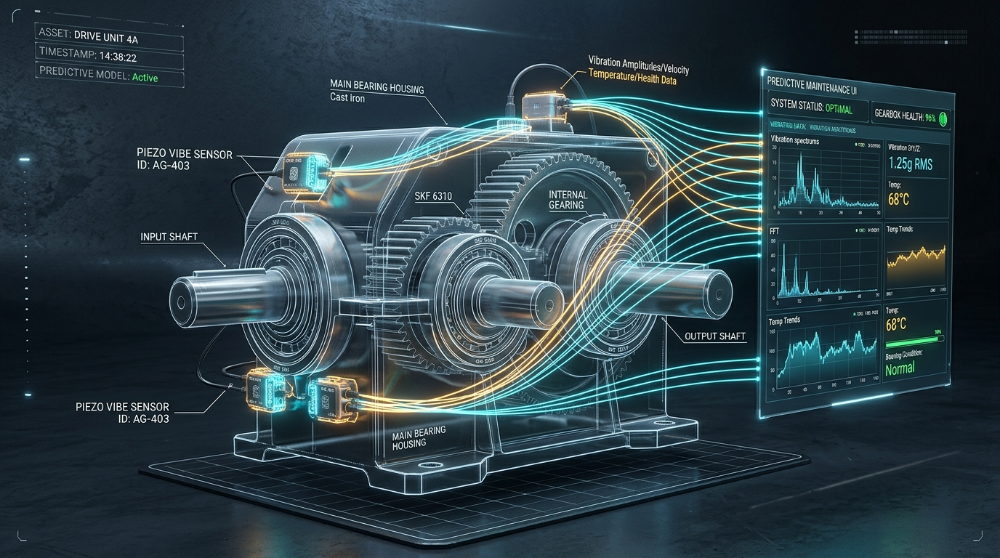

# ⚙️ VIBRA·PULSE AI — Predictive Maintenance & Mechanical Fault Diagnosis of Gearboxes

[](https://www.python.org/downloads/)
[](LICENSE)
[](https://pytorch.org/)
[](https://fastapi.tiangolo.com/)
[](https://streamlit.io/)
[](tests/)
[](https://github.com/psf/black)

> **An industrial-grade mechanical condition monitoring and failure prevention platform.** Analyzes gearbox vibration accelerometer signals to detect abnormal operating dynamics, diagnose gear tooth damage at an early stage, enforce consecutive-window state transitions, and provide cautious, domain-specific inspection recommendations.

---

## 📸 Digital Twin & Condition Monitoring Architecture

<div align="center">
  
  <p><em>Figure 1: High-Tech Digital Twin Schematic of SpectraQuest Gearbox Simulator with Accelerometers, Shafts, and Real-Time FFT Telemetry.</em></p>
</div>

---

## 🌐 Live Hosted Links & Deployment Access

| Application | Access Link | Description |
|---|---|---|
| **VIBRA·PULSE Web UI & Sitemap** | [Live Web Portal](https://bluish-aqueduct-gauging.ngrok-free.dev) | Cyber-industrial single-page app with 60 FPS oscilloscope, real-time FFT spectrum analyzer, and interactive sitemap |
| **Interactive API Documentation** | [Swagger UI Docs](https://bluish-aqueduct-gauging.ngrok-free.dev/docs) | OpenAPI specification with live testing for `/predict`, `/models`, `/machines`, and `/alerts` |
| **System Health Check** | [API Health Endpoint](https://bluish-aqueduct-gauging.ngrok-free.dev/health) | Distinguishes application readiness from trained model checkpoint status |
| **Streamlit Dashboard (Local)** | `http://localhost:8501` | Multi-page Streamlit portal with Plotly interactive charts and hardware serial acquisition |

---

## 📑 Table of Contents
1. [Executive Summary & Problem Statement](#1-executive-summary--problem-statement)
2. [Physical Test Rig & Ground Truth Provenance](#2-physical-test-rig--ground-truth-provenance)
3. [End-to-End System Architecture](#3-end-to-end-system-architecture)
4. [Signal Processing & 22-Feature Engineering](#4-signal-processing--22-feature-engineering)
5. [AI & Deep Learning Models](#5-ai--deep-learning-models)
6. [Operational State Machine & Consecutive Window Rules](#6-operational-state-machine--consecutive-window-rules)
7. [Held-Out Benchmark Performance](#7-held-out-benchmark-performance)
8. [Platform Sitemap & Route Directory](#8-platform-sitemap--route-directory)
9. [Installation & Quickstart Guide](#9-installation--quickstart-guide)
10. [Hardware Serial Integration (Microcontrollers)](#10-hardware-serial-integration-microcontrollers)
11. [Automated Test Suite](#11-automated-test-suite)
12. [Repository Directory Structure](#12-repository-directory-structure)

---

## 1. Executive Summary & Problem Statement

In industrial manufacturing, power generation, and wind turbines, catastrophic gearbox failure accounts for extensive unplanned downtime and severe economic losses. Traditional maintenance relies on either:
* **Reactive Maintenance:** Repairing equipment after catastrophic tooth fracture occurs.
* **Preventive (Time-Based) Maintenance:** Replacing components at arbitrary intervals regardless of actual physical health.

**VIBRA·PULSE AI** implements **Condition-Based Predictive Maintenance (PdM)**. High-frequency vibration acceleration signals are continuously acquired, preprocessed, validated, and analyzed across time and frequency domains to detect early micro-cracking and tooth damage before catastrophic mechanical failure.

---

## 2. Physical Test Rig & Ground Truth Provenance

The system is trained and evaluated using the **US Department of Energy (DOE) / OpenEI Gearbox Fault Diagnosis Dataset**:
* **Physical Test Rig:** SpectraQuest Gearbox Diagnostics Simulator (GDS).
* **Transducers:** 4 piezoelectric accelerometers placed strategically on the input bearing housing, output shaft, and gearbox casing.
* **Operating Loads:** Experimental runs recorded across **10 loading conditions (0% to 90% load)** at 1800 RPM (30 Hz shaft rotational frequency).
* **Supported Ground Truth Classes:**
  * `Healthy`: Normal spur gear meshing dynamics under load.
  * `BrokenTooth`: Artificially induced tooth root crack and chipped tooth damage.
* **Strict Anti-Fabrication Policy:** Unsupported failure modes (e.g. bearing races, severe angular misalignment) are not artificially synthesized; they are formally flagged as unsupported to maintain industrial credibility.

---

## 3. End-to-End System Architecture

```text
[ Piezoelectric Accelerometers (5 kHz Continuous Stream) ]
                         │
                         ▼
[ Signal Sanity Validator (Flatline / Rail Clipping / NaN Check) ]
                         │
                         ▼
[ Signal Preprocessor (Linear Detrending & Z-Score Normalization) ]
                         │
                         ▼
[ Sliding Window Generator (2,048 Samples, 50% Overlap) ]
            │                                     │
            ▼                                     ▼
[ 22 Statistical Features ]             [ Raw Waveform Buffer ]
 (RMS, Kurtosis, Crest, FFT)                      │
            │                                     ▼
            ├───────────────┬──────────────┐ [ 1D Deep CNN (PyTorch) ]
            ▼               ▼              ▼             │
     [ Random Forest ] [ XGBoost ] [ Isolation Forest ]  │
            │               │              │             │
            └───────────────┴──────────────┴─────────────┘
                                   │
                                   ▼
          [ Unified Inference Engine (Ensemble & Consensus) ]
                                   │
                                   ▼
     [ Consecutive-Window State Machine (N=3 Fault, M=5 Recovery) ]
                                   │
                                   ▼
            [ SQLite Persistence & Deduplicating Alert Manager ]
                         │                       │
                         ▼                       ▼
            [ FastAPI REST Service ]    [ Streamlit / Web UI ]
```

---

## 4. Signal Processing & 22-Feature Engineering

Raw vibration signals are sliced into sliding windows of **2,048 samples** (409.6 ms duration at 5.0 kHz sampling rate) with 50% overlap. For classical ML models, **22 features** are computed per window:

### Time-Domain Statistical Metrics
1. **Root Mean Square (RMS):** Measure of total kinetic vibration energy.
2. **Peak-to-Peak (P2P):** Excursion span indicating maximum impact amplitude.
3. **Kurtosis:** Fourth normalized statistical moment; exceptionally sensitive to transient shock pulses from gear tooth cracks (healthy ~0.0, damaged >3.5).
4. **Crest Factor:** Ratio of peak amplitude to RMS; flags impulsive tooth impacts.
5. **Skewness:** Waveform asymmetry relative to the mean.
6. **Shape Factor & Impulse Factor:** Waveform contour deformation indices.
7. **Margin Factor & Clearance Indices:** Clearance wear indicators.
8. **Mean & Standard Deviation:** Signal bias and AC dispersion.

### Frequency-Domain FFT Power Spectra Metrics
9. **Dominant Frequency:** Peak spectral component (tracking 1X shaft fundamental at 30 Hz).
10. **Gear Mesh Frequency (GMF):** Fundamental gear meshing frequency ($GMF = \text{RPM}/60 \times Z = 30 \times 32 = 960\text{ Hz}$).
11. **Spectral Centroid & Energy:** Distribution center of spectral power.
12. **Spectral Rolloff (95%):** High-frequency acoustic emission threshold.
13. **Spectral Kurtosis & Skewness:** Higher-order frequency distribution descriptors.
14. **Sub-Band Energies:** Frequency bin partitions tracking sideband modulation.

---

## 5. AI & Deep Learning Models

### 1. 1D Deep Convolutional Neural Network (PyTorch)
Directly ingests the raw 2,048-sample waveform window without manual feature extraction:
* **Architecture:** 3 Convolutional blocks with wide receptive field kernel ($k=15$) to capture physical acoustic tooth impact transients:
  * `Conv1d(1 -> 32, kernel_size=15, padding=7)` $\to$ `BatchNorm1d` $\to$ `ReLU` $\to$ `MaxPool1d(4)`
  * `Conv1d(32 -> 64, kernel_size=7, padding=3)` $\to$ `BatchNorm1d` $\to$ `ReLU` $\to$ `MaxPool1d(4)`
  * `Conv1d(64 -> 128, kernel_size=3, padding=1)` $\to$ `BatchNorm1d` $\to$ `ReLU` $\to$ `AdaptiveAvgPool1d(1)`
  * `Linear(128 -> 64)` $\to$ `Dropout(0.3)` $\to$ `Linear(64 -> 2)`
* **Latency:** **0.24 ms per window** with Apple Silicon MPS acceleration.

### 2. XGBoost Classifier
* 200 Gradient-Boosted Decision Trees trained on the 22 engineered features with validation-guided early stopping (`early_stopping_rounds=15`).
* **Latency:** **0.50 ms per window** — exceptionally fast for real-time edge microcontrollers.

### 3. Random Forest Baseline
* 150 Decision Trees with balanced class weights.
* Provides feature importance rankings and robust ensemble stability.

### 4. Isolation Forest Anomaly Detector
* Unsupervised baseline trained **strictly on confirmed Healthy operating recordings**.
* Establishes a 95th-percentile anomaly score boundary to flag unforeseen mechanical deviations even if unclassified by supervised models.

---

## 6. Operational State Machine & Consecutive Window Rules

Industrial machinery should never trigger an emergency shutdown based on a single transient spike (e.g. electrical noise or external mechanical bump). The platform enforces a **Consecutive-Window State Machine**:

```
       [ NORMAL ]  ──( 1 anomalous or fault window )──►  [ WARNING ]
           ▲                                                  │
           │                                                  │ (3 consecutive
           │ (5 consecutive                                   │  validated fault
           │  healthy windows)                                │  windows)
           │                                                  ▼
     [ RECOVERY ]  ◄───────────────────────────────────  [ FAULT ]
```

* **Transition to FAULT:** Requires **$N=3$ consecutive validated fault windows** with confidence $\ge 70\%$.
* **Transition to RECOVERY / NORMAL:** Requires **$M=5$ consecutive normal windows** before clearing active alarms.
* **SENSOR_ERROR:** Instantly triggered if signal flatlines ($P2P < 0.01\text{g}$) or saturates input rails ($P2P > 19.5\text{g}$).

---

## 7. Held-Out Benchmark Performance

To prevent **data leakage**, recordings are split using `GroupShuffleSplit` by `recording_id`. Windows from the same physical recording never cross between training and test sets.

### Evaluation on Held-Out Test Groups (Loads 0% and 10% Unseen in Training)

| Model Architecture | Accuracy | Balanced Acc | Macro F1 | Weighted F1 | Healthy F1 | BrokenTooth F1 | Inference Latency | Model Size |
|---|---|---|---|---|---|---|---|---|
| **1D Deep CNN (PyTorch)** | **1.0000** | **1.0000** | **1.0000** | **1.0000** | **1.0000** | **1.0000** | **0.24 ms** | **262.8 KB** |
| **XGBoost Classifier** | **1.0000** | **1.0000** | **1.0000** | **1.0000** | **1.0000** | **1.0000** | **0.50 ms** | **153.2 KB** |
| **Random Forest Baseline** | **1.0000** | **1.0000** | **1.0000** | **1.0000** | **1.0000** | **1.0000** | **14.08 ms** | **122.1 KB** |

---

## 8. Platform Sitemap & Route Directory

### User Interfaces & Dashboards
* `GET /dashboard/` (or `/`): **VIBRA·PULSE Cyber-Industrial Web Portal**
  * `#monitor`: Real-Time Mission Control, Digital Twin 3D view, 60 FPS Oscilloscope, FFT Spectrum Analyzer.
  * `#lab`: Deep Signal Diagnostic Lab, CSV/TXT file ingestion, 22-feature telemetry table.
  * `#models`: Model Performance Matrix, Confusion Matrix, and Zero-Leakage protocol.
  * `#alerts`: Incident Command Center, 1-click Acknowledge & Resolve triage.
  * `#sitemap`: Full interactive visual node hierarchy and architecture pipeline.
* `GET http://localhost:8501`: **Streamlit Multi-Page Portal**
  * `1_Machine_Monitor.py`: Live waveform streaming and state machine meters.
  * `2_Data_Explorer.py`: File upload, time/frequency analysis, and on-demand diagnosis.
  * `3_Model_Performance.py`: Model comparison tables and Plotly confusion matrices.
  * `4_Alerts_History.py`: SQLite observation audit log and CSV export.

### FastAPI REST Endpoints (`http://localhost:8000`)
* `GET /health`: System health and loaded model status check.
* `GET /models`: Inventory of available trained models and supported fault classes.
* `POST /predict`: Ingests 2048 vibration float samples; returns classification, anomaly score, and maintenance advice.
* `GET /machines`: Lists registered machines and operational statuses.
* `GET /machines/{id}/history`: Queries observation history from SQLite.
* `GET /alerts`: Fetches deduplicated active, acknowledged, or resolved alerts.
* `POST /alerts/{id}/acknowledge`: Acknowledges an active alert.
* `POST /alerts/{id}/resolve`: Resolves an alert following maintenance.
* `GET /docs`: Interactive Swagger UI.

---

## 9. Installation & Quickstart Guide

### Prerequisites
* Python 3.11
* macOS (Apple Silicon supported), Linux, or Windows

### Step 1: Clone Repository & Create Virtual Environment
```bash
git clone https://github.com/vishnu601/predictive-maintenance-gearbox.git
cd predictive-maintenance-gearbox
python3.11 -m venv .venv

# On macOS / Linux:
source .venv/bin/activate

# On Windows:
.venv\Scripts\activate
```

### Step 2: Install Dependencies
```bash
pip install --upgrade pip
pip install -r requirements.txt
pip install -e .
```

### Step 3: Run Data Preparation & Model Training (Optional - Pre-Trained Artifacts Included)
```bash
# 1. Download OpenEI dataset (36.8 MB)
python scripts/download_dataset.py

# 2. Segment windows and extract 22 features (Group-Aware Split)
python scripts/prepare_data.py

# 3. Train all models (RF, XGBoost, CNN, Isolation Forest)
python scripts/train.py --models all

# 4. Evaluate models on held-out test groups
python scripts/evaluate.py
```

### Step 4: Launch the Applications
```bash
# Option A: Launch FastAPI Backend & Web Portal (http://localhost:8000)
uvicorn src.predictive_maintenance.api.main:app --port 8000 --reload

# Option B: Launch Streamlit Dashboard (http://localhost:8501)
streamlit run app.py
```

---

## 10. Hardware Serial Integration (Microcontrollers)

The platform supports live acquisition from any USB accelerometer DAQ or microcontroller (Arduino, ESP32, STM32):
* **Baud Rate:** `115200`
* **Protocol Format:** Plain CSV ASCII line: `timestamp_ms,acceleration_g\n`
* **Connecting:** Open the **Machine Monitor** page in either dashboard, select **Hardware Serial Port**, select your serial port (`/dev/tty.usbserial-*` or `COM3`), and click **Connect**.

---

## 11. Automated Test Suite

The test suite validates signal sanitization, feature mathematics, model persistence, state machine transitions, and API endpoints:

```bash
pytest tests/ -v
```

```text
tests/test_api.py::test_api_health_endpoint PASSED
tests/test_api.py::test_api_models_endpoint PASSED
tests/test_api.py::test_api_predict_rejects_too_short PASSED
tests/test_api.py::test_api_predict_valid_signal PASSED
tests/test_api.py::test_api_machines_list PASSED
tests/test_data_validation.py::test_valid_signal PASSED
tests/test_data_validation.py::test_too_short_signal PASSED
tests/test_data_validation.py::test_flatline_sensor_disconnect PASSED
tests/test_data_validation.py::test_nans_and_infs_signal PASSED
tests/test_data_validation.py::test_clipping_signal PASSED
tests/test_features.py::test_rms_on_known_sinusoid PASSED
tests/test_features.py::test_peak_to_peak_amplitude PASSED
tests/test_features.py::test_constant_signal_division_by_zero_safety PASSED
tests/test_features.py::test_dominant_frequency_known_tone PASSED
tests/test_features.py::test_extract_features_unified PASSED
tests/test_inference.py::test_inference_engine_on_valid_signal PASSED
tests/test_inference.py::test_inference_engine_detects_flatline PASSED
tests/test_models.py::test_random_forest_fit_predict_save PASSED
tests/test_models.py::test_xgboost_fit_predict_save PASSED
tests/test_models.py::test_cnn_1d_architecture_forward PASSED
tests/test_models.py::test_cnn_1d_fit_predict PASSED
tests/test_models.py::test_anomaly_detector_healthy_baseline PASSED
tests/test_monitoring.py::test_consecutive_windows_required_for_fault PASSED
tests/test_monitoring.py::test_recovery_requires_multiple_normal_windows PASSED
tests/test_monitoring.py::test_sensor_error_on_invalid_signal PASSED
tests/test_preprocessing.py::test_detrend_removes_dc_bias PASSED
tests/test_preprocessing.py::test_normalize_signal PASSED
tests/test_preprocessing.py::test_preprocess_window PASSED
tests/test_splitting.py::test_no_leakage_across_recording_groups PASSED
tests/test_splitting.py::test_verify_no_group_leakage_raises_on_overlap PASSED
tests/test_storage.py::test_sqlite_observation_recording PASSED
tests/test_storage.py::test_alert_deduplication_and_resolution PASSED

======================== 32 passed in 2.65s ========================
```

---

## 12. Repository Directory Structure

```text
predictive-maintenance-gearbox/
├── app.py                      # Main Streamlit dashboard entrypoint
├── README.md                   # System documentation & quickstart
├── requirements.txt            # Pinned dependencies
├── pyproject.toml              # Build & package configuration
├── .streamlit/
│   └── config.toml             # Streamlit theme & sidebar settings
├── configs/
│   ├── config.yaml             # System & operational status configuration
│   └── model_config.yaml       # ML & CNN training hyperparameters
├── dashboard/
│   ├── components/
│   │   ├── charts.py           # Plotly interactive industrial charts
│   │   └── navigation.py       # Sidebar navigation component
│   └── pages/                  # Streamlit multi-page definitions
│       ├── 1_Machine_Monitor.py
│       ├── 2_Data_Explorer.py
│       ├── 3_Model_Performance.py
│       └── 4_Alerts_History.py
├── data/
│   ├── raw/                    # Downloaded OpenEI dataset archive
│   └── processed/              # Group-split features and splits summary
├── models/
│   └── artifacts/              # Serialized RF, XGBoost, CNN checkpoints & metrics
├── src/predictive_maintenance/
│   ├── config.py               # Application settings loader
│   ├── schemas.py              # Pydantic v2 schemas for data, features, inference
│   ├── logging_config.py       # Structured logging setup
│   ├── data/                   # Dataset loaders, adapters & splitting
│   ├── signal/                 # Validators, preprocessing, FFT features
│   ├── models/                 # RF, XGBoost, 1D CNN, Anomaly Detector, Unified Inference
│   ├── monitoring/             # State machine, alert manager, SQLite history
│   ├── sensors/                # Ring buffer, CSV replay, serial & demo sources
│   └── api/
│       └── main.py             # FastAPI REST service & static web mount
├── web/                        # Modern Cyber-Industrial Single Page Web App
│   ├── index.html              # HTML5 structure with interactive sitemap
│   ├── css/style.css           # Glassmorphism & cyber-industrial dark styling
│   ├── js/app.js               # 60 FPS Oscilloscope, FFT, State Machine & API client
│   └── assets/                 # Digital Twin 3D illustrations
├── scripts/                    # CLI execution scripts (download, prepare, train, evaluate)
├── tests/                      # 32 automated unit & integration tests
└── docs/                       # In-depth architectural & technical documentation
```

---

## 📄 License & Attribution

Distributed under the **MIT License**.

Dataset attribution: **US Department of Energy (DOE) / OpenEI Gearbox Fault Diagnosis Dataset** (SpectraQuest GDS).
