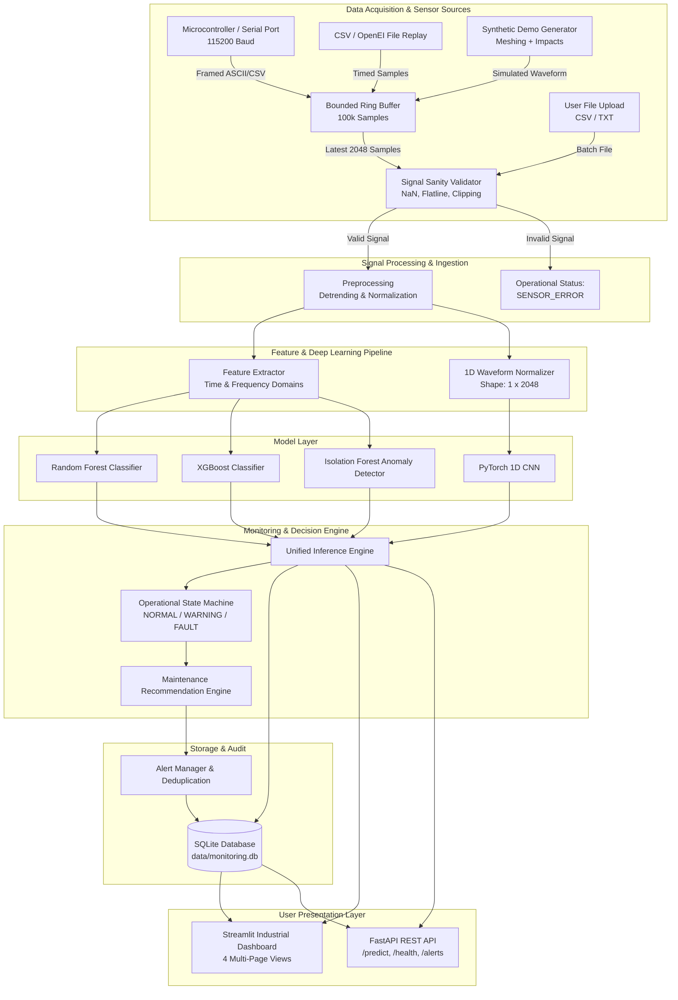

# System Architecture & Technical Specifications

This document outlines the end-to-end software architecture for the **AI-Based Predictive Maintenance and Fault Diagnosis Platform for Gearboxes**.

---

## 1. High-Level System Architecture

The platform bridges real-time and offline vibration data ingestion with signal preprocessing, feature engineering, multi-algorithm classification, an operational state machine, persistence, and an industrial user interface.

---

## 2. Component Breakdown

### 2.1 Sensor Sources & Bounded Buffering (`src/predictive_maintenance/sensors/`)
- **BoundedVibrationBuffer**: A thread-safe circular ring buffer backed by `collections.deque(maxlen=100000)`. Memory consumption remains strictly bounded ($O(1)$) regardless of whether the sensor runs for minutes or days.
- **SerialSensorSource**: Uses `pySerial` in a non-blocking background daemon thread to stream serial telemetry, parsing incoming packets (`timestamp,sample_value` or single floating-point values) with automatic reconnection handling.
- **CSVReplaySensorSource**: Streams historical experimental recordings at nominal sampling rates (e.g. 5,000 Hz) to allow realistic simulation without physical hardware.
- **SyntheticDemoSensorSource**: Generates mathematically sound gear-meshing signals ($f_{\text{mesh}} = Z \cdot f_{\text{shaft}}$) and transient impact modulations, visibly tagged as `SYNTHETIC_DEMO`.

### 2.2 Signal Validation & Preprocessing (`src/predictive_maintenance/signal/`)
- **Sanity Checks**:
  1. *Flatline Check*: Rejects signals with $\sigma < 10^{-5}$, indicating a disconnected accelerometer or frozen ADC.
  2. *Clipping Check*: Flags saturated signals exceeding the accelerometer dynamic range ($\pm 100\,\text{g}$).
  3. *Integrity Check*: Rejects non-numeric, `NaN`, or infinite values.
- **Preprocessing**:
  - Zero-mean detrending ($x[n] - \mu$).
  - Z-score normalization fitted strictly on training data to prevent leakage.

### 2.3 Feature Engineering (`src/predictive_maintenance/signal/features.py`)
- **Time-Domain Indicators**: Mean, Standard Deviation, RMS, Min/Max, Peak-to-Peak, Absolute Peak, Crest Factor, Shape Factor, Impulse Factor, Skewness, and Kurtosis (Fisher's excess kurtosis where Gaussian = 0.0, and Pearson kurtosis where Gaussian = 3.0).
- **Frequency-Domain Indicators**: One-sided Fast Fourier Transform (FFT) magnitude spectrum, Power Spectral Density (PSD), Dominant Peak Frequency, Peak Spectral Magnitude, Spectral Centroid, Spectral Bandwidth (spread), Spectral Energy, Spectral Entropy, and frequency-band power ratios.

### 2.4 Leakage-Free Group Splitting (`src/predictive_maintenance/data/splitting.py`)
- Slicing continuous vibration signals into overlapping windows creates strong autocorrelations. To ensure scientific integrity, we employ `GroupShuffleSplit` partitioned strictly by `recording_id`.
- Windows from any specific physical recording run exist *exclusively* in either the training set, validation set, or held-out test set. Automated tests enforce that no recording identifier spans multiple splits.

### 2.5 Operational State Machine (`src/predictive_maintenance/monitoring/rules.py`)
- Prevents false alarms from transient sensor spikes:
  - **NORMAL $\rightarrow$ WARNING**: 1 anomalous window or uncertain fault prediction.
  - **WARNING $\rightarrow$ FAULT**: $N$ consecutive confirmed fault windows (default: $N=3$) with confidence $\ge 70\%$.
  - **FAULT $\rightarrow$ NORMAL**: $M$ consecutive healthy windows (default: $M=5$) required to verify physical recovery.
  - **SENSOR_ERROR**: Immediate state if signal validation fails.
